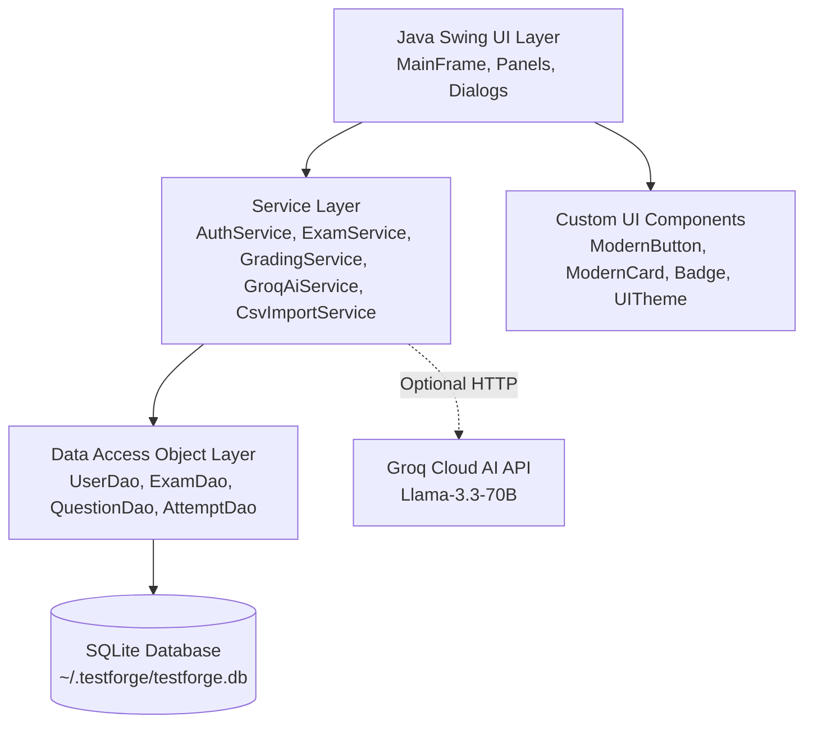
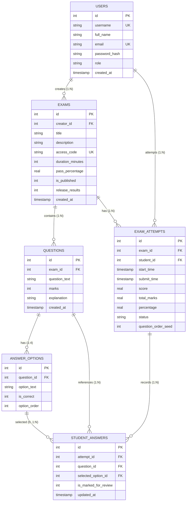

# TestForge — Forge your future.
**Desktop Examination & Assessment System**

> TestForge is a modern, dark-themed Java Swing desktop application designed for universities, colleges, and schools to conduct secure, computerized exams. It provides separate dashboards for **Exam Creators** (to draft, manage, randomize, and grade exams) and **Students** (to take exams with a real-time countdown timer, autosave, and question randomization).

---

## 1. Project Overview & Objectives

### Tagline
> **“Forge your future.”**

### Core Objectives
1. **Academic Honesty & Fairness:** Randomize question sequence and multiple-choice options per student attempt so neighboring candidates see different question layouts and option orders.
2. **Reliable Exam Taking:** Continuous background autosaving of student answers to prevent data loss upon power fluctuation or accidental window minimization.
3. **Tamper-Resistant Grading:** Exam evaluation is performed strictly on the database/service layer against ground truth answer keys; the client interface is never trusted for final scores.
4. **Creator Productivity:** Rapid question authoring with manual forms, bulk CSV spreadsheet imports, and optional AI-assisted question generation via Groq API.
5. **Beginner-Friendly Architecture:** Clean, understandable Java classes without Spring Boot, microservices, or complex enterprise scaffolding—ideal for college viva demonstrations.

---

## 2. Technology Stack

| Technology | Purpose & Why It Was Chosen |
|---|---|
| **Java 21** | Modern LTS release providing Records, Pattern Matching, virtual threads capability, and enhanced HTTP client. |
| **Java Swing** | Core GUI library built into Java standard distribution; allows completely offline, zero-dependency desktop deployment without browser wrappers. |
| **FlatLaf 3.4** | Clean, modern dark-themed look-and-feel featuring deep navy backgrounds (`#0B132B`, `#1C2541`) and electric-blue accents (`#38BDF8`), avoiding outdated default Swing aesthetics. |
| **SQLite** | Zero-configuration, serverless, self-contained relational database stored in the user's home directory (`~/.testforge/testforge.db`). Eliminates external database setup (no MySQL or PostgreSQL daemon required). |
| **JDBC** | Standard Java Database Connectivity using `PreparedStatement` with parameterized queries to prevent SQL injection. |
| **BCrypt (`jbcrypt`)** | Military-grade salted password hashing algorithm (`BCrypt.hashpw`, `BCrypt.checkpw`) to avoid storing plain-text passwords. |
| **Groq API** | Optional AI integration via built-in `java.net.http.HttpClient` to synthesize university-level MCQs from pasted study notes using `llama-3.3-70b-versatile`. |
| **Maven** | Standard dependency management and standalone fat-JAR packaging (`mvn package`). |

---

## 3. System Architecture & Database Design

### Application Architecture Diagram



### Database Entity-Relationship (ER) Diagram



---

## 4. Key Features

### Role-Based Access Control
- **Two User Roles:** `Exam Creator` and `Student`.
- **BCrypt Hashing:** Passwords are never stored in plain text. Hashed with salt (work factor 12).
- **Session Protection:** Students cannot access creator question-builder screens; unauthorized access attempts are redirected to login.

### Creator Studio
- **Exam Management:** Create, edit, publish/unpublish, and delete exams with confirmation dialogs.
- **Access Codes:** Auto-generates unique exam codes (e.g., `TF-9B7X` or custom `JAVA-101`).
- **Question Builder:** Manual authoring of questions, marks per question, 4 options, selection of correct answer, and detailed explanations.
- **CSV Bulk Import:** Import hundreds of questions in one click from `.csv` files.
- **Groq AI Question Generator:** Paste study notes, specify count (1–10) and difficulty, review/edit generated questions, and approve before adding to exam.
- **Submission Analytics:** View student names, emails, scores, percentages, and pass/fail status.
- **Paper Inspection:** Review the exact choices made by any student compared with correct answers.
- **Result Visibility Control:** Creators can hold results or release them to students immediately.

### Student Portal & Examination Engine
- **Pre-Exam Lobby:** Shows exam title, duration, question count, pass criteria, and rules before the clock starts.
- **Question & Option Randomization:** Shuffles questions and the 4 options (A, B, C, D) using an attempt-specific seed.
- **Stable ID Mapping:** Student choices are recorded against stable database IDs, never display letters, preventing grading errors.
- **Real-Time Countdown Timer:** Safe `javax.swing.Timer` running on the Event Dispatch Thread (EDT) displaying `MM:SS`. Visual warnings when under 5 minutes.
- **Live Autosave:** Changing an answer option writes immediately to SQLite; work is preserved across accidental window closes.
- **Anti-Cheating Safeguards:** Single active attempt per student, window closing warning with automatic graceful submission, and auto-submit on timer expiration.
- **Scorecard & Review:** Detailed breakdown showing questions, selected answer, correct answer, and explanation (if released by creator).

---

## 5. Folder & Package Structure

```
D:\TestForge
├── pom.xml                               # Maven project configuration
├── sample_questions.csv                  # Ready-to-import sample CS questions
├── README.md                             # Complete project documentation
├── target                                # Compiled classes and standalone JAR
│   └── testforge-1.0.0.jar               # Runnable standalone executable JAR
└── src
    └── main
        └── java
            └── com
                └── testforge
                    ├── app
                    │   └── Main.java             # Entry point (theme & DB bootstrap)
                    ├── database
                    │   ├── DatabaseInitializer.java # Tables DDL and seed data
                    │   └── DatabaseManager.java     # SQLite connection provider
                    ├── dao
                    │   ├── AttemptDao.java          # Student attempts & answers
                    │   ├── ExamDao.java             # Exam CRUD & access codes
                    │   ├── QuestionDao.java         # Questions & answer options
                    │   └── UserDao.java             # User queries & authentication
                    ├── model
                    │   ├── AnswerOption.java        # Option entity (text, is_correct)
                    │   ├── Exam.java                # Exam entity & settings
                    │   ├── ExamAttempt.java         # Student attempt session
                    │   ├── Question.java            # Question entity with options
                    │   ├── QuestionReviewItem.java  # Graded review model
                    │   ├── StudentAnswer.java       # Chosen option & review mark
                    │   └── User.java                # User credentials & role
                    ├── service
                    │   ├── AuthService.java         # Login, registration, BCrypt
                    │   ├── CsvImportService.java    # RFC-4180 CSV parser & validator
                    │   ├── ExamService.java         # Exam lifecycle & randomization
                    │   ├── GradingService.java      # Server-side score evaluation
                    │   └── GroqAiService.java       # Groq AI chat completion client
                    ├── ui
                    │   ├── components
                    │   │   ├── Badge.java           # Colored status pills
                    │   │   ├── ModernButton.java    # Rounded hoverable buttons
                    │   │   ├── ModernCard.java      # Dark navy rounded panel
                    │   │   ├── ModernPasswordField.java
                    │   │   ├── ModernTextField.java
                    │   │   └── UITheme.java         # Color palette & FlatLaf setup
                    │   ├── AiQuestionDialog.java    # AI generation review modal
                    │   ├── CreatorDashboardPanel.java# Creator exams & builder
                    │   ├── ExamEditorDialog.java    # Question editor & CSV import
                    │   ├── ExamResultsDialog.java   # Scorecard & answer paper view
                    │   ├── ExamTakingFrame.java     # Live examination window
                    │   ├── LoginPanel.java          # Login screen & demo buttons
                    │   ├── MainFrame.java           # Root window & screen router
                    │   ├── RegisterPanel.java       # User registration screen
                    │   ├── StudentAttemptsDialog.java# Creator submission monitor
                    │   └── StudentDashboardPanel.java# Student lobby & exam history
                    └── util
                        ├── PasswordUtil.java        # BCrypt hashing helper
                        ├── SanityCheck.java         # Automated verification script
                        ├── SessionManager.java      # In-memory authenticated user
                        └── ValidationUtil.java      # Email, input, and type checks
```

---

## 6. How to Open and Run in IntelliJ IDEA

### Step 1: Open the Project
1. Launch **IntelliJ IDEA**.
2. Select **File → Open...**
3. Browse to and select `D:\TestForge` (or wherever this project directory is located).
4. Click **OK**. Choose **Open as Project**.

### Step 2: Configure Project SDK
1. Go to **File → Project Structure... → Project**.
2. Set **SDK** to **Java 21** (or modern OpenJDK / JetBrains Runtime).
3. Set **Language Level** to **21**.
4. Click **Apply** and **OK**.

### Step 3: Maven Sync
1. Open the **Maven** side tool window on the right.
2. Click the **Reload All Maven Projects** icon (the two circular arrows).
3. Maven will index `sqlite-jdbc`, `jbcrypt`, `flatlaf`, and `json`.

### Step 4: Run the Application
- Locate `src/main/java/com/testforge/app/Main.java`.
- Right-click `Main.java` and select **Run 'Main.main()'**.
- The dark-themed TestForge window will launch immediately!

---

## 7. How to Run via Command Line / Terminal

Make sure `JAVA_HOME` is set to your Java 21 JDK.

### Method 1: Run with Maven
```powershell
cd D:\TestForge
mvn compile exec:java
```

### Method 2: Run Standalone Packaged JAR
```powershell
cd D:\TestForge
java -jar target\testforge-1.0.0.jar
```

### Method 3: Run Internal Engine Verification
```powershell
java -cp target\testforge-1.0.0.jar com.testforge.util.SanityCheck
```

---

## 8. Pre-Seeded Demo Accounts for College Viva

TestForge comes with pre-seeded accounts and a pre-configured sample exam so you can demonstrate the application immediately without typing everything manually:

### 1. Exam Creator Demo
- **Email:** `creator@testforge.com`
- **Password:** `password123`
- *(Convenient "Exam Creator Demo" one-click button available on the login screen!)*

### 2. Student Demo
- **Email:** `student@testforge.com`
- **Password:** `password123`
- *(Convenient "Student Demo" one-click button available on the login screen!)*

### 3. Pre-Configured Sample Exam
- **Access Code:** `JAVA-101`
- **Title:** `Java Core & OOP Fundamentals`
- **Duration:** 15 Minutes
- **Status:** Published & Result Release Enabled

---

## 9. Configuring Optional Groq AI Question Generation

Groq AI is completely optional; manual question creation and CSV importing work 100% offline.

To enable AI generation:
1. Obtain a free API key at [console.groq.com/keys](https://console.groq.com/keys).
2. Set the environment variable:
   ```powershell
   [System.Environment]::SetEnvironmentVariable("GROQ_API_KEY", "your_groq_api_key_here", "User")
   ```
3. Alternatively, you can simply paste your key into the **Groq API Key** field inside the AI Question Generator dialog in TestForge.
4. If no key is set or internet is unavailable, TestForge displays an informative error message and all core features continue running normally.

---

## 10. Sample CSV Question File Format

Creators can import questions in bulk from `.csv` files. A sample file `sample_questions.csv` is included in the project root.

### Format Specification
Columns must be in this order:
```csv
Question,Option A,Option B,Option C,Option D,Correct Option,Marks,Explanation
```

### Example Row
```csv
"What is the average time complexity of searching a HashMap?","O(1)","O(log N)","O(N)","O(N log N)","A",1,"HashMap achieves O(1) average search through hashing."
```

### Rules
- Quotes (`"`) around text allow commas inside questions or options.
- `Correct Option` can be specified as `A`, `B`, `C`, or `D`.
- `Marks` is an integer (default 1).
- `Explanation` is optional and displayed to students upon result release.

---

## 11. Manual Testing Checklist for Demonstration

Follow these steps to demonstrate every feature during an evaluation:

| # | Feature to Test | Step-by-Step Action | Expected Result |
|---|---|---|---|
| **1** | **User Registration** | Click "Register here", fill details for role "Student", submit. | Account created; redirected to sign in. |
| **2** | **Creator Login** | Click "Exam Creator Demo" or type `creator@testforge.com` / `password123`. | Creator Studio opens displaying "My Exams" table. |
| **3** | **Create New Exam** | Go to "Create New Exam", type title "Algorithms Quiz", click "Auto-Generate" code, duration 20 mins, click "Create Exam". | Exam created; builder dialog opens immediately. |
| **4** | **Add Manual Question** | In Question Builder, enter question, 4 options, click radio button for correct option, click "Save Question". | Question appears in the table with correct option indicator. |
| **5** | **Import CSV** | Click "Import from CSV", pick `sample_questions.csv`. | Dialog shows "Successfully imported 10 questions". |
| **6** | **AI Generation (Optional)** | Click "Generate via Groq AI", click "Generate MCQs". | Cards load with generated questions; click "Add Approved to Exam". |
| **7** | **Publish Exam** | In "Manage My Exams", click "Publish / Unpublish". | Status updates to `PUBLISHED`. |
| **8** | **Student Login** | Click "Sign Out", click "Student Demo" button. | Student Portal opens. |
| **9** | **Enter Exam** | Enter `JAVA-101`, click "Find Exam". | Pre-exam lobby loads showing duration, marks, and instructions. |
| **10** | **Take Exam** | Click "Start Exam Now". | Exam screen opens with live countdown timer, randomized questions, and palette. |
| **11** | **Autosave** | Select an answer, jump to question 3, return to question 1. | Option remains selected; stored in database. |
| **12** | **Accidental Close Warning** | Click window close (X). | Confirmation prompt appears warning that progress will be submitted. |
| **13** | **Submit & View Results** | Click "Submit Exam" and confirm. | Exam submitted; Scorecard dialog shows marks, percentage, pass/fail badge, and breakdown. |
| **14** | **Creator Verification** | Sign out, log back into Creator account, select exam, click "View Submissions". | Student's attempt is recorded with score and submission timestamp. |

---

## 12. Known Limitations & Anti-Cheating Scope

For academic honesty during college evaluation, explain the boundaries of this desktop application:

1. **Local Demonstration Database:** Uses a local SQLite database file in `~/.testforge/testforge.db`. For multi-lab deployment, a centralized server (`HttpServer` or REST backend) is required to prevent multiple machines accessing a single file.
2. **OS-Level Anti-Cheating:** TestForge does not block keyboard shortcuts (e.g. `Alt+Tab`, `PrintScreen`) or multi-monitor setups. Operating-system-level restrictions require dedicated kiosk software or specialized proctoring daemons.
3. **Randomization Strategy:** Question order and option positions are shuffled per attempt using pseudorandom seeds, which mitigates simple screen-peeking among adjacent desks.
4. **Offline Capability:** Core features function with zero internet connection; only the optional Groq AI question generator requires an active network connection.

---

## 13. College Viva Preparation — 15 Common Questions & Answers

### Q1: Why did you choose SQLite over MySQL or PostgreSQL?
> **Answer:** SQLite is a serverless, embedded database that requires zero configuration or external services. For a college desktop demonstration, it ensures that the application runs out-of-the-box on any examiner's computer without installing database servers or configuring ports and credentials.

### Q2: How does TestForge prevent SQL Injection?
> **Answer:** We strictly use JDBC `PreparedStatement` with parameterized placeholders (`?`). The database driver pre-compiles the query and treats user inputs strictly as literals/data, neutralizing any embedded SQL syntax attacks.

### Q3: Why is BCrypt better than MD5 or SHA-256 for passwords?
> **Answer:** MD5 and SHA-256 are fast hash functions vulnerable to brute-force and rainbow table lookups. BCrypt automatically includes a random cryptographic salt and incorporates a configurable work factor (cost) that makes brute-force attacks computationally infeasible.

### Q4: How does question and option randomization work without corrupting grading?
> **Answer:** When an attempt starts, an attempt-specific seed shuffles the question list and the 4 options. Crucially, student answers are stored in the database against the immutable `option_id` and `question_id`, never the displayed letter (`A, B, C, D`). Grading joins `student_answers` with `answer_options.is_correct` in the database.

### Q5: How is the timer implemented so students cannot freeze it?
> **Answer:** The timer is implemented using `javax.swing.Timer`, which fires every 1000ms safely on Swing's Event Dispatch Thread. To prevent tampering, the remaining time is calculated by subtracting `currentTime - startTime` from `duration_minutes * 60`. Even if a user minimizes the app or navigates questions, the clock keeps accurate wall-clock time.

### Q6: What is the Event Dispatch Thread (EDT) in Java Swing?
> **Answer:** Swing is single-threaded. The Event Dispatch Thread handles all GUI rendering, button clicks, and mouse events. Heavy operations (like database transactions or Groq API calls) are offloaded to background threads or `SwingWorker` so the UI never freezes.

### Q7: Why do we use transactions (`conn.setAutoCommit(false)`) when saving questions or submitting exams?
> **Answer:** A question consists of one row in the `questions` table and four rows in `answer_options`. A transaction ensures **Atomicity**: either all rows are inserted successfully, or if any fails, the entire operation is rolled back, preventing orphaned records.

### Q8: How does the CSV import handle commas inside question text?
> **Answer:** We implemented an RFC-4180 compliant tokenizer in `CsvImportService`. When a comma is encountered inside quotation marks (`"..."`), the parser treats it as literal text rather than a column delimiter.

### Q9: How is the Groq AI integration designed to stay resilient?
> **Answer:** Groq API calls run in a background `SwingWorker` with strict timeouts. We request a JSON schema from the model (`llama-3.3-70b-versatile`). If the API key is missing or the network is offline, user-friendly warnings are displayed and the core exam builder remains 100% operational.

### Q10: Where is the database stored?
> **Answer:** In `System.getProperty("user.home") + "/.testforge/testforge.db"`. This ensures predictability across Windows, macOS, and Linux without relying on the current working directory.

### Q11: What prevents students from altering their scores?
> **Answer:** The client UI does not compute or submit a score. When the student clicks submit, the UI simply calls `GradingService.calculateAndSubmitExam(attemptId)`. The server calculates scores by querying correct answers directly from the database.

### Q12: What design patterns did you use in this project?
> **Answer:** 
> - **DAO Pattern (Data Access Object):** Separates database queries (`UserDao`, `ExamDao`) from business logic.
> - **Model-View-Service:** Models represent entities, Services handle business operations, and UI panels handle rendering.
> - **Singleton / Session Pattern:** `SessionManager` maintains current user state across panels.

### Q13: Can a student take the same exam multiple times?
> **Answer:** By default, `ExamService.startOrResumeExamAttempt()` checks whether a completed attempt (`SUBMITTED` or `TIMED_OUT`) exists for that `(exam_id, student_id)`. If so, it blocks duplicate attempts.

### Q14: How does FlatLaf modernize Java Swing?
> **Answer:** FlatLaf is a modern look-and-feel library that supports dark themes, vector scaling (HiDPI displays), rounded component borders, and modern typography without altering Swing's standard API.

### Q15: What would be the next step to scale this for 1,000 concurrent students across campus?
> **Answer:** Replace the embedded SQLite file with a centralized RESTful backend (or Java HTTP server) backed by PostgreSQL, running HTTPS with JWT tokens and a connection pool like HikariCP.
